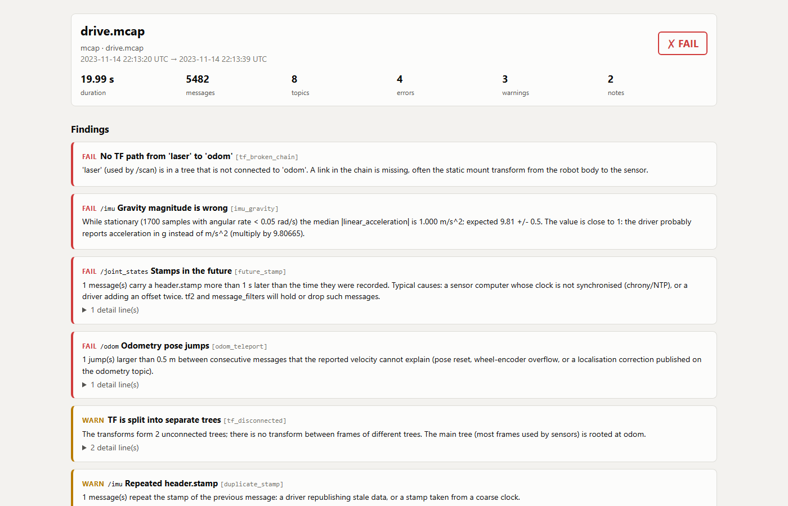
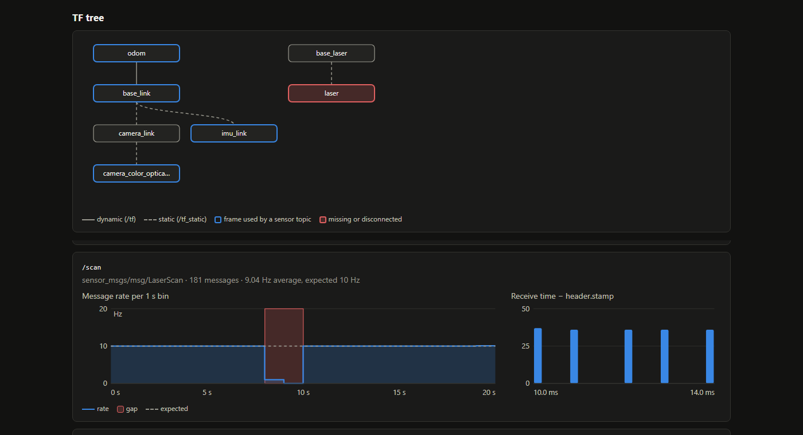

# rosbag-inspect

[](https://github.com/projectbin07-stack/rosbag-inspect/actions/workflows/ci.yml)
[](LICENSE)

Health-check a ROS 2 bag without a ROS install, and explain what is wrong with the recording.

`rosbag-inspect` is a Python command-line tool with no dependencies outside the standard library.
It reads rosbag2 bags in SQLite3 (`.db3`) or MCAP format, decodes the common robot message types
from their CDR bytes, and checks message rates, gaps, timestamps, the TF tree and the sensor data
itself (LaserScan, IMU, odometry, cmd_vel response). It prints a pass/warn/fail verdict with times
and counts for every problem, and can write JSON for CI or a self-contained HTML report.



## Why it exists

A rosbag recorded on a robot is often the only evidence of what went wrong, and the problems that
spoil it are frequently in the recording rather than the robot: a LiDAR that stopped for two
seconds, an IMU driver that reports acceleration in g, a sensor computer whose clock is an hour
ahead, a static transform that was never published. These are easy to miss when replaying the bag
in RViz and slow to find by hand with `ros2 bag info` and `ros2 topic echo`.

Inspecting a bag usually means having a matching ROS distribution installed, which is not the case
on a laptop used for triage, in a CI job, or on Windows. `rosbag-inspect` runs anywhere Python 3.10+
runs and turns the common recording faults into a list of findings with explanations.

### How it differs from existing tools

| Tool | What it is | Where `rosbag-inspect` differs |
| --- | --- | --- |
| `ros2 bag info` | Lists topics, counts and duration (needs ROS 2). | Runs without ROS and looks inside the messages: gaps, stamps, TF, sensor sanity. |
| [rosbags](https://gitlab.com/ternaris/rosbags) | Pure-Python library to read, write and convert ROS 1/ROS 2 bags. | A checker with a verdict, explanations and exit codes rather than a library; reads only what the checks need. |
| [mcap CLI](https://mcap.dev/guides/cli) | Inspects, validates and converts MCAP files (Go). | Interprets ROS 2 content (CDR, TF, LaserScan, IMU, Odometry) and also reads `.db3` bags. |
| Foxglove / PlotJuggler | Interactive visualisation of recorded data. | Headless and scriptable: the same report every time, suitable for CI. |

No code was taken from these projects. Formats were implemented from their specifications; see
[docs/formats.md](docs/formats.md) for the references.

## Features

Reading
- rosbag2 bag directories (with or without `metadata.yaml`), single `.db3` and `.mcap` files, and
  split bags (several files merged in time order).
- SQLite3 storage from Foxy-style (schema version 1) to current schemas.
- MCAP: summary section and chunk index when present (only chunks containing the requested topics
  are read), linear scan otherwise, which also recovers data from files cut off by an interrupted
  recording. Unchunked and chunked files; chunk CRCs are verified.
- Chunk compression: none and LZ4 (pure-Python decoder) everywhere; zstd through the
  standard-library `compression.zstd` on Python 3.14+, or on any version with the optional
  `zstandard` package (`pip install "rosbag-inspect[zstd]"`). Without either, zstd chunks give a
  clear error that says how to fix it.
- `metadata.yaml` with a small safe YAML parser (no object construction, no anchors or tags).
- Message definitions from MCAP `ros2msg` schemas, plus a built-in table for `.db3` bags:
  `std_msgs/Header`, `String`, `sensor_msgs/LaserScan`, `Imu`, `JointState`, `Image`,
  `CompressedImage`, `nav_msgs/Odometry`, `geometry_msgs/Twist`, `TwistStamped`, `PoseStamped`
  and their dependencies, `tf2_msgs/TFMessage`.
- CDR decoder driven by the parsed definitions: primitives, strings, fixed/bounded/unbounded
  arrays, nested types, XCDR1 alignment (and plain XCDR2). Image and other large byte payloads are
  never copied into memory: only their length is recorded.

Checks (each finding has a code, a severity and the times involved)

| Code | Severity | What it means |
| --- | --- | --- |
| `gap` | warning | inter-arrival time above `--gap-factor` x the expected (or median) period and `--min-gap` |
| `high_jitter` | warning | inter-arrival standard deviation above half the period |
| `rate_mismatch` / `expected_topic_missing` | error | `--expect TOPIC:HZ` not met |
| `high_latency` | warning | 95th percentile of receive time - `header.stamp` above `--max-latency` |
| `future_stamp` | error | `header.stamp` more than 1 s after the receive time |
| `stamp_after_receive` | warning | stamp slightly after receive time (clock offset between machines) |
| `zero_stamp` | error | `header.stamp` never set |
| `stamp_out_of_order`, `duplicate_stamp` | warning | stamps going backwards or repeating |
| `sim_time_stamps` | info | stamps look like simulation time; latency checks skipped |
| `frame_id_changes`, `empty_frame_id` | warning | inconsistent or empty `frame_id` on a topic |
| `tf_missing_frame` | error | a sensor's `frame_id` never appears in `/tf` or `/tf_static` |
| `tf_broken_chain` | error | a sensor frame is in a TF tree not connected to the main one |
| `tf_multiple_parents`, `tf_cycle` | error | TF is not a tree |
| `tf_disconnected` | warning | TF consists of several unconnected trees |
| `tf_static_and_dynamic`, `tf_leading_slash` | warning | the same transform on `/tf` and `/tf_static`; `/frame` names |
| `laser_config`, `laser_angle_mismatch` | error | invalid limits; `angle_increment` inconsistent with the number of ranges |
| `laser_out_of_range`, `laser_invalid_share`, `laser_scan_time` | warning/info | finite ranges outside `[range_min, range_max]`; NaN/inf share; `scan_time` vs. rate |
| `imu_gravity` | error | median \|acceleration\| while stationary not 9.81 m/s^2, with a hint (g units, gravity removed, factor 2) |
| `imu_quaternion_norm`, `imu_non_finite` | error | orientation not a unit quaternion although provided; NaN/inf |
| `imu_field_not_provided`, `imu_negative_variance` | warning | covariance `-1` markers on rates/accelerations; negative variances |
| `imu_no_orientation`, `imu_zero_covariance` | info | the `-1` / all-zero covariance conventions of `sensor_msgs/Imu` |
| `odom_teleport` | error | pose jump the reported velocity cannot explain |
| `odom_twist_mismatch`, `odom_yaw_rate_mismatch` | warning | twist disagrees with the motion of the pose (body frame) |
| `cmd_vel_opposite` | error | the robot moves against the command |
| `cmd_vel_no_response`, `cmd_vel_slow_response` | warning | odometry does not reach half the command within 1 s / 0.5 s |
| `cmd_vel_response` | info | measured command-to-motion latency |
| `image_size_mismatch`, `joint_state_lengths` | error | size fields of `Image`, array lengths of `JointState` |
| `decode_error` | error | messages that do not match their definition |
| `recording_incomplete`, `metadata_count_mismatch` | warning | recorder killed (no `metadata.yaml`, no MCAP footer, truncated file); stale metadata |
| `empty_topic`, `not_decoded`, `tf_absent` | info | nothing recorded on a topic; no definition available; no TF in the bag |

Event topics (`/rosout`, `/parameter_events`, service and action topics) are not checked for gaps
or jitter unless `--expect` names them.

Output
- Terminal summary with a verdict; `--json` with every statistic and finding.
- Exit codes for CI: 0 pass, 1 warnings (only with `--strict`), 2 errors or an unreadable bag.
- `--report out.html`: one self-contained file (inline CSS and SVG, no JavaScript, no external
  resources) with findings, a topic table, a TF tree diagram, per-topic rate timelines with gap
  markers and expected rate, and latency histograms. Light and dark themes follow the system
  setting.



## Install

```console
pip install git+https://github.com/projectbin07-stack/rosbag-inspect.git
```

or from a clone: `pip install .` (Python 3.10 or newer; no other packages are installed). The
package is not published on PyPI.

## Quick start

The outputs below are from the generated test drive (`python tests/make_fixtures.py OUT_DIR`),
run with version 0.1.0. It is a 20 s simulated drive of a mecanum robot with deliberate faults.

```console
$ rosbag-inspect info drive_sqlite
rosbag-inspect 0.1.0  drive_sqlite
  storage    sqlite3 (1 file(s))
  sqlite3    schema version 3, ros_distro humble
  metadata   version 5, 5482 messages
  duration   19.992 s
  messages   5482

  topic                 count        Hz  type
  /camera/image_raw       100      5.00  sensor_msgs/msg/Image
  /cmd_vel                200     10.00  geometry_msgs/msg/Twist
  /imu                   2000    100.00  sensor_msgs/msg/Imu
  /joint_states          1000     50.00  sensor_msgs/msg/JointState
  /odom                  1000     50.00  nav_msgs/msg/Odometry
  /scan                   181      9.04  sensor_msgs/msg/LaserScan
  /tf                    1000     50.00  tf2_msgs/msg/TFMessage
  /tf_static                1         -  tf2_msgs/msg/TFMessage
```

```console
$ rosbag-inspect check drive_sqlite
rosbag-inspect 0.1.0  drive_sqlite
  storage    sqlite3: drive_sqlite_0.db3
  duration   19.992 s, 5482 messages

  topic                count    avg Hz   min Hz    max Hz  gaps   lat p95
  /camera/image_raw      100      5.00     5.00      5.00     0    30.0ms
  /cmd_vel               200     10.00    10.00     10.00     0         -
  /imu                  2000    100.00   100.00    100.00     0     2.0ms
  /joint_states         1000     50.00    50.00     50.00     0     4.0ms
  /odom                 1000     50.00    50.00     50.00     0     5.0ms
  /scan                  181      9.04     0.50     10.42     1    14.0ms
  /tf                   1000     50.00    50.00     50.00     0         -
  /tf_static               1         -        -         -     0         -

  FAIL  No TF path from 'laser' to 'odom' [tf_broken_chain]
        'laser' (used by /scan) is in a tree that is not connected to 'odom'. A link in the chain is missing, often the static mount transform from the robot body to the sensor.
  FAIL  /imu: Gravity magnitude is wrong [imu_gravity]
        While stationary (1700 samples with angular rate < 0.05 rad/s) the median |linear_acceleration| is 1.000 m/s^2; expected 9.81 +/- 0.5. The value is close to 1: the driver probably reports acceleration in g instead of m/s^2 (multiply by 9.80665).
  FAIL  /joint_states: Stamps in the future [future_stamp]
        1 message(s) carry a header.stamp more than 1 s later than the time they were recorded. Typical causes: a sensor computer whose clock is not synchronised (chrony/NTP), or a driver adding an offset twice. tf2 and message_filters will hold or drop such messages.
        - received at +6.004 s: stamp is 3599.996 s ahead
  FAIL  /odom: Odometry pose jumps [odom_teleport]
        1 jump(s) larger than 0.5 m between consecutive messages that the reported velocity cannot explain (pose reset, wheel-encoder overflow, or a localisation correction published on the odometry topic).
        - +11.985 s -> +12.005 s: position jumped 0.803 m in 0.020 s while twist reports 0.200 m/s
  WARN  TF is split into separate trees [tf_disconnected]
        The transforms form 2 unconnected trees; there is no transform between frames of different trees. The main tree (most frames used by sensors) is rooted at odom.
        - root odom: base_link, camera_color_optical_frame, camera_link, imu_link, odom
        - root base_laser: base_laser, laser
  WARN  /imu: Repeated header.stamp [duplicate_stamp]
        1 message(s) repeat the stamp of the previous message: a driver republishing stale data, or a stamp taken from a coarse clock.
        - received at +5.002 s: stamp 1700000004.990000000 repeated
  WARN  /scan: Gaps in the message stream [gap]
        1 inter-arrival time(s) above 303.0 ms (3 x the median period of 101.0 ms). Longest: 2.000 s starting at +8.010 s.
        - +8.010 s -> +10.010 s: 2.000 s without messages (~19 expected messages missing)
  INFO  /cmd_vel: cmd_vel response [cmd_vel_response]
        Odometry reached half the commanded velocity 164 ms (median of 2 start-from-rest command(s)) after the command was recorded (/cmd_vel -> /odom).
        - 164 ms
        - 164 ms
  INFO  /scan: Readings without a valid return [laser_invalid_share]
        2.8% of readings are NaN/inf (0 NaN, 1810 +inf, 0 -inf).

verdict: FAIL (4 error(s), 3 warning(s), 2 note(s))
$ echo $?
2
```

Other commands:

```console
$ rosbag-inspect check drive.mcap --expect /scan:10 --expect /imu:100 --report report.html
$ rosbag-inspect check drive.mcap --json > report.json
$ rosbag-inspect echo drive.mcap /odom --limit 1
{"topic": "/odom", "log_time_ns": 1700000000005000000, "message": {"header": {"stamp": {"sec": 1700000000, "nanosec": 0}, "frame_id": "odom"}, "child_frame_id": "base_link", "pose": {"pose": {"position": {"x": 0.0, ...
$ rosbag-inspect export drive.mcap /imu imu.csv
wrote 2000 row(s), 41 column(s) to imu.csv
```

`echo` prints one JSON object per message; NaN and infinities are written as the strings
`"NaN"`, `"Infinity"`, `"-Infinity"` so the output stays valid JSON (or as `null` with
`--nonfinite null`), and large byte arrays appear as `{"skipped_bytes": N}`. `export` writes the
receive time, `header.stamp` (as `stamp_ns`) and every numeric field with dotted column names
(fixed-size arrays such as covariances become `.0` ... `.35`; variable-length arrays contribute
`name.length`; strings are left out). With `--arrays`, every numeric variable-length array is also
written in full in a column of its own name, as space-separated numbers in Python's shortest
round-trip form, with non-finite values as `inf`, `-inf` and `nan`:

```console
$ rosbag-inspect export drive.mcap /scan scan.csv --arrays
wrote 181 row(s), 15 column(s) to scan.csv
$ python -c "import csv; r = next(csv.DictReader(open('scan.csv'))); print(r['ranges'][:44])"
inf inf inf inf inf inf inf inf inf inf 2.46
```

`float()` reads each value back exactly as it was decoded (float32 values widened to float64),
so a LaserScan keeps every beam, including the REP 117 `+inf` / `-inf` / `NaN` markers.

On Windows with Git Bash, MSYS rewrites arguments that start with `/` into paths
(`/scan` becomes `C:/Program Files/Git/scan`). Run with `MSYS_NO_PATHCONV=1` or use PowerShell.

### Command reference

```text
usage: rosbag-inspect [-h] [--version] {info,check,echo,export} ...

positional arguments:
  {info,check,echo,export}
    info                list topics, types, counts and storage details
    check               run the health checks and print a verdict
    echo                print decoded messages as JSON lines
    export              write the numeric fields of a topic to CSV

usage: rosbag-inspect check [-h] [--report HTML] [--json] [--strict] [--expect TOPIC:HZ]
                            [--rate-tolerance FRACTION] [--gap-factor N] [--min-gap S]
                            [--max-latency S] [--gravity-tolerance M_S2] [--teleport M]
                            bag

Run all checks. Exit code: 0 pass, 1 warnings (only with --strict), 2 errors or unreadable bag.

  --report HTML         write a self-contained HTML report
  --json                print the report as JSON
  --strict              exit 1 when there are warnings
  --expect TOPIC:HZ     expected rate of a topic, e.g. --expect /scan:10 (repeatable)
  --rate-tolerance FRACTION
                        allowed deviation from --expect rates (default 0.2 = 20%)
  --gap-factor N        report gaps longer than N x the expected/median period (default 3)
  --min-gap S           never report gaps shorter than this (default 0.25 s)
  --max-latency S       warn when p95 of receive time - header.stamp exceeds this (default 0.25 s)
  --gravity-tolerance M_S2
                        allowed deviation of stationary |acceleration| from 9.81 (default 0.5)
  --teleport M          odometry jumps above this between messages are errors (default 0.5 m)

usage: rosbag-inspect echo [-h] [--limit N] [--nonfinite {string,null}] bag topic
                                                             (default limit 10, 0 = all)
usage: rosbag-inspect export [-h] [--arrays] bag topic output
                                                             (output '-' = stdout)
usage: rosbag-inspect info [-h] [--json] bag
```

## How the checks work

- Rates and gaps use the recorder's receive times (`timestamp` in `.db3`, `log_time` in MCAP).
  The expected period is `1 / --expect` or the median inter-arrival time.
- Latency is receive time minus `header.stamp`. Stamps far before 2001 while the recorder runs
  on wall time are treated as simulation time.
- The IMU gravity check uses samples whose angular rate is below 0.05 rad/s, so the robot needs
  to stand still or drive straight for part of the recording. The median |acceleration| of those
  samples is compared with 9.80665 m/s^2.
- Odometry velocity is compared with the change of pose between consecutive messages, rotated
  into the body frame (`nav_msgs/Odometry` expresses twist in `child_frame_id`), which also
  covers mecanum strafing (`linear.y`).
- cmd_vel response: for every command that starts from rest, the time until the odometry
  velocity in the commanded direction reaches half the commanded value. Only topics whose name
  ends in `cmd_vel` are matched against `/odom` (or the first odometry topic).
- TF: frames from `/tf` and `/tf_static` form a graph; the main tree is the one containing most
  of the frames used by sensor `frame_id`s (and odometry `child_frame_id`s).

## Architecture

```text
src/rosbag_inspect/
  yamlmini.py        safe YAML subset parser
  metadata.py        metadata.yaml model
  msgdef.py          .msg parser, ros2msg bundles, built-in definitions, registry
  cdr.py             CDR (XCDR1 / plain XCDR2) decoder and encoder
  lz4.py             pure-Python LZ4 frame decoder
  mcap.py            MCAP reader (summary + chunk index, or linear scan)
  sqlite_storage.py  rosbag2 SQLite3 reader
  bag.py             opens a directory / file, merges split bags, unified message stream
  timing.py          rates, gaps, jitter, stamp and latency checks
  tfcheck.py         TF graph checks
  sensors.py         LaserScan, Imu, Odometry, cmd_vel, Image, JointState checks
  analysis.py        runs everything in one pass over the bag -> Report
  findings.py        Finding / TopicStats / Report models, verdict, JSON
  html_report.py     self-contained HTML with inline SVG
  export.py          JSON-friendly values and flat CSV columns
  cli.py             info | check | echo | export
```

The bag is read once; each message is decoded only if a definition is known, and per-topic
collectors keep only what the checks need (times, stamps, a few numbers per message).

## Testing

```console
pip install -e ".[dev,zstd]"
ruff check . && ruff format --check . && mypy && pytest --cov
```

The fixtures are generated, not downloaded: `tests/bagwriter.py` contains a small SQLite3 bag
writer, an MCAP writer (chunked or not, with or without summary, LZ4 or zstd chunks) and a
minimal LZ4 compressor; `tests/drive.py` simulates the 20 s drive with these faults:

1. a 2 s LiDAR gap on `/scan`,
2. a duplicated stamp on `/imu`,
3. IMU acceleration in g instead of m/s^2,
4. a broken TF chain (`base_laser -> laser` not connected to `base_link`),
5. a `/joint_states` message stamped one hour in the future,
6. an odometry pose jump of 0.8 m.

`tests/test_fixtures.py` asserts the exact list of findings for every storage layout (SQLite3,
chunked MCAP, LZ4 MCAP, unchunked MCAP, MCAP without summary), with the expected values derived by
hand in its docstring. Other tests cover CDR round trips for every built-in type and hand-built
byte layouts (alignment after strings, XCDR2 4-byte alignment, empty sequences, big-endian), the
YAML subset, LZ4 edge cases, corrupted/truncated MCAP files, and HTML well-formedness.

## Compatibility

The synthetic fixtures are written by this project's own writers, so they cannot prove that
real recordings are read correctly. As an additional check, the reader was run locally against
bags produced by real rosbag2 recorders: the test resources of the
[rosbag2](https://github.com/ros2/rosbag2) repository (Apache-2.0), downloaded from the
`humble` branch (commit `f4873d0`) and the `rolling` branch (commit `c73ae2d`) on 2026-11-19:

| Resource | Storage | Notes |
| --- | --- | --- |
| `rosbag2_tests/resources/cdr_test` (humble) | `.db3`, schema version 2 | types not built in, timing only |
| `rosbag2_tests/resources/sqlite3/cdr_test` (rolling) | `.db3`, schema version 4 | as above |
| `rosbag2_tests/resources/mcap/cdr_test` (rolling) | MCAP, libmcap 0.8.0 | `test_msgs/Arrays`, `BasicTypes` decoded from the schemas |
| `rosbag2_py/test/resources/{mcap,sqlite3}/talker` (rolling) | MCAP with **zstd** chunks, `.db3` | `rcl_interfaces/Log`, `std_msgs/String` |
| `rosbag2_tests/resources/mcap/bag_with_topics_and_service_events_and_action` (rolling) | MCAP, libmcap 1.4.0 | service/action event topics |
| `rosbag2_py/test/resources/mcap/wbag` (rolling) | split MCAP, 5 files | 6074 messages merged |

All files opened, message counts match their `metadata.yaml`, and every message with a known
definition decoded with the definition consuming the whole payload (at most 3 bytes of end
padding). `tests/test_real_bags.py` repeats this when `ROSBAG_INSPECT_SAMPLES` points to a
directory with these bags; the files are not committed and CI does not run these tests.

What has **not** been verified: bags recorded on a robot with `ros2 bag record` (no such
recording with a compatible licence was available), the sensor message types (`LaserScan`,
`Imu`, `Odometry`, `TFMessage`, `Image`) from a real driver, bags written by Cyclone DDS
publishers, and per-message zstd compression in `.db3` files written by rosbag2 (it is
implemented and tested only with this project's writer). If a real bag is read wrongly, please
open an issue.

## Known limitations

- `.db3` files carry no message definitions; only the built-in types are decoded from them.
  Other topics get timing checks only (`not_decoded`).
- zstd-compressed MCAP chunks and per-message zstd compression need Python 3.14+ or the
  optional `zstandard` package (`rosbag-inspect[zstd]`); without either they produce a clear
  error. File-level compressed bags (`*.db3.zstd`) must be decompressed first.
- `ros2idl` schemas, `wstring`, parameter-list and delimited CDR encodings are not supported.
- MCAP attachments and metadata records are ignored. The LZ4 decoder does not verify xxHash
  checksums (the MCAP chunk CRC-32 is verified).
- `info` shows per-topic rates for `.db3` bags only (MCAP statistics give one time span for the
  whole file).
- Pure Python: reading is roughly 10,000 messages per second on a desktop for the simulated drive
  (5482 messages in about 0.5 s, measured with `check` on Windows 11, Python 3.14); very large bags
  take correspondingly long.
- The thresholds are heuristics meant for small ground robots (e.g. the IMU stationary detection
  uses only the angular rate). Adjust them with the command-line options.
- TF checks look at frame connectivity, not at transform timing (no extrapolation checks).

## Roadmap

- Per-topic time spans for MCAP `info` from the message indexes.
- PointCloud2 and NavSatFix sanity checks.
- TF timing: stale dynamic transforms and lookups that would extrapolate.
- A `--topics` filter for `check` and a Markdown report for pull-request comments.

## License

MIT, see [LICENSE](LICENSE).
